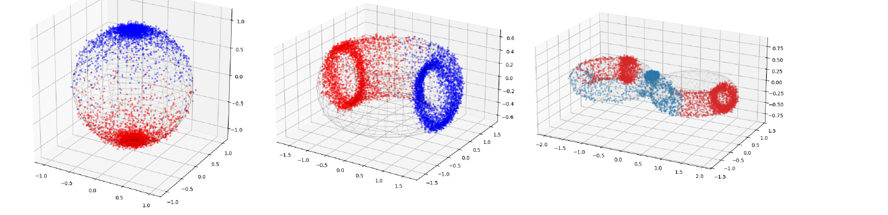

# Final project: Aspects of Flow Matching

*Amey Gaikwad and Sven Harder*

A flow model that transports data along curved submanifolds of R³ (sphere, torus, genus-2 surface). A metric is first learned from the data with K-Means/RBF. One network then learns geodesics of that metric, which serve as curved interpolants, and a second network learns the flow vector field that generates them.

- [Aspects_of_Flow_Matching_report.pdf](Aspects_of_Flow_Matching_report.pdf): write-up
- [flow_matching_on_manifolds.ipynb](flow_matching_on_manifolds.ipynb): code
